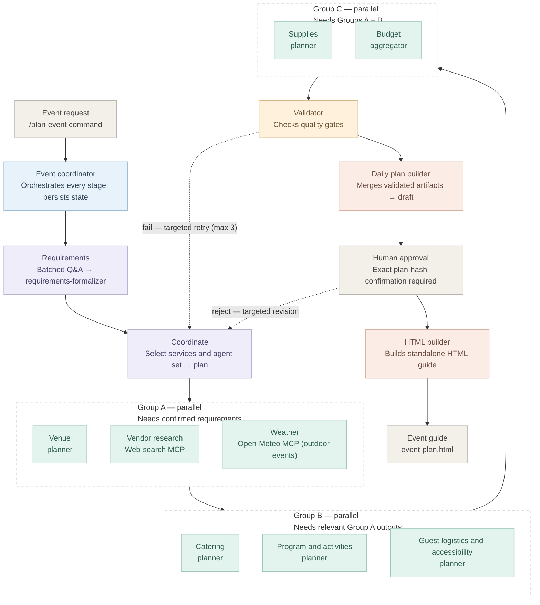

# Reliable Event Planner Workflow

A Claude Code `/plan-event` workflow that confirms event requirements, selects specialist agents by need and dependencies, researches current sources through MCP, validates artifacts, persists progress, and renders a standalone HTML event guide only after deterministically verified human approval.

## Architecture

The coordinator owns orchestration, not event recommendations. Independent agents in each group can run in parallel; groups run in dependency order. The dashed edges represent targeted retry and revision paths.



## Prerequisites

- Claude Code installed and a recent Claude model available.
- Python 3.10+ on `PATH` (the project hooks invoke `python`).
- [uv](https://docs.astral.sh/uv/) for the custom MCP server and its dependencies.
- A Brave Search API key (`BRAVE_API_KEY`) for live web research. Open-Meteo forecast requests do not require a key.
- Network access to Brave Search and Open-Meteo.

## Setup

1. Clone the repository and open its root in Claude Code.
2. Install the custom MCP server dependency:

   ```powershell
   uv sync --project mcp/event-research
   ```

3. Set the Brave key in the environment used to launch Claude Code. For the current PowerShell session:

   ```powershell
   $env:BRAVE_API_KEY = "your-key"
   ```

   Restart Claude Code after setting it so the `event-research` MCP server inherits the value. Alternatively configure it in your user-level secret manager/environment. `.env.example` documents the variable name; do not put a real key there or commit it. `.mcp.json` passes the environment variable to the local server.
4. Trust the project MCP server when Claude Code prompts. Confirm that `event-research` is connected and exposes `search_web` and `get_weather_forecast`. The coordinator pauses if required live search is unavailable; it does not fall back to model-only sourcing.
5. Confirm the project hooks are active in Claude Code. They are configured in `.claude/settings.json` and invoke the scripts in `.claude/hooks/`.

## Run an event plan

Start a new run with a request, for example:

```text
/plan-event Plan a community fundraiser for about 80 guests in Portland on 2027-05-15. Indoor venue, accessible seating, vegetarian options, and a total budget under USD 8,000.
```

The coordinator creates a unique local run under `runs/`, saves the input/state, asks a batched set of questions for missing critical details, and waits for confirmation. Research uses the configured MCP search tools; only relevant agents are selected. Searches should include only the minimum event location/service context—never guest names, contact details, or other attendee personal data. Agent Markdown artifacts share the structure in `.claude/skills/artifact-validator/SKILL.md` and include direct sources. No quoted price or availability is assumed without evidence.

After successful quality gates, the coordinator presents the draft and computes its SHA-256. To approve that exact plan, reply exactly:

```text
APPROVE <64-character lowercase SHA-256>
```

To reject it, reply `REVISE: <specific feedback>`. The plan is revised and revalidated, then submitted for approval again. A simple “yes” or approval of an earlier revision does not unlock final generation. Before a final HTML write, the PreToolUse hook verifies the persisted approval, recomputes the current plan hash, and confirms that the exact approval appears as a direct user message in the current Claude session transcript. The HTML builder returns the rendered content; the coordinator writes it in the same session that received approval. Missing transcript evidence blocks the write.

The final standalone guide is `runs/<run-id>/event-plan.html`. It uses the reusable `event-guide-theme` skill and `template.html`. Final output omits internal workflow paths and artifact filenames.

## Resume and persistence

Every active run stores `input.md`, `workflow-state.json`, and agent-owned artifacts under `runs/<run-id>/`. The PostToolUse hook updates artifact hashes/timestamps after writes. The coordinator records agent statuses, dependencies, retries, gate results, and approval revision in the state file. Live `runs/` are local and git-ignored; the three reviewed fixture runs under `examples/runs/` are version-controlled.

Resume after a process or session interruption with:

```text
/plan-event --resume runs/<run-id>
```

The coordinator preserves completed artifacts whose hashes still match and continues only pending, failed, or invalidated work. Changes to an upstream input invalidate only its downstream dependents. It never resumes final generation with stale or missing approval. A quality gate gets at most three targeted retries per affected agent; exhausted failures block dependent steps and are reported with their owners and evidence.

## Workflow files

- `CLAUDE.md` — repository-wide workflow contract and execution/recovery rules.
- `.claude/commands/plan-event.md` — coordinator slash command.
- `.claude/agents/` — specialist agents, validator, synthesis, and renderer.
- `.claude/skills/` — reusable artifact-validation and guide-theme skills.
- `.claude/hooks/` — approval, no-leak, and post-write state hooks.
- `.mcp.json`, `mcp/event-research/` — custom MCP server for Brave web search and Open-Meteo.
- `examples/runs/` — three illustrative sample runs with inputs, artifacts, and execution state. They are fixtures, not live vendor quotes or current recommendations.

## Checks

Run the standard-library hook tests and syntax checks:

```powershell
python -m unittest discover -s tests -v
python -m py_compile .claude/hooks/approval_gate.py .claude/hooks/no_leak_guard.py .claude/hooks/post_write_state.py mcp/event-research/server.py
```

Live web searches require network access and `BRAVE_API_KEY`; Open-Meteo forecasts require network access but no Brave key. Do not use real event attendee personal data in sample runs. Never commit credentials, local `.env` files, or private run data.
